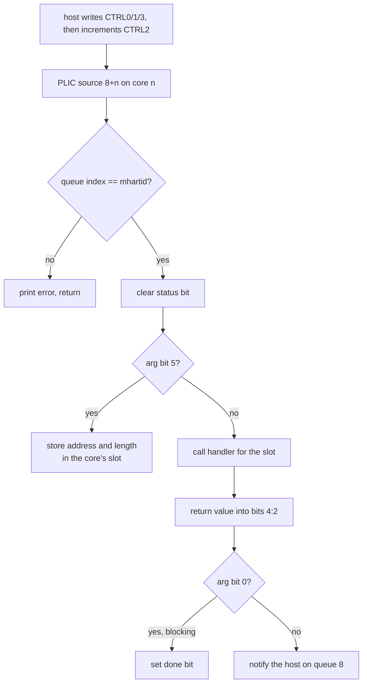

# Mailbox and Host Commands

The host configures the firmware through the mailbox block at
`0x1EC0C000`. Each core has its own queue; queue 8 carries notifications
from the NPU back to the host.

## Registers

```
+0x000             interrupt status, write 1 to clear
+0x004 + n*4       interrupt mask n; mask n+1 = 1<<n routes queue n to core n
+0x030 + q*0x10    CTRL0  buffer address
+0x034 + q*0x10    CTRL1  length (16 bits)
+0x038 + q*0x10    CTRL2  doorbell counter, the sender increments it
+0x03C + q*0x10    CTRL3  arg and status (16 bits)
+0x140 + n*4       MIB n, parameter and handshake words
```

CTRL3 bits:

| bits  | meaning                                   |
| ----- | ----------------------------------------- |
| 0     | sender waits for completion               |
| 1     | done                                      |
| 4:2   | handler return value                      |
| 5     | store only: keep the buffer, call nothing |
| 14:11 | function slot                             |

## Response status

The status field is a three-bit protocol value, not a negative Linux errno.
Values in `enum npu_mbox_status` match the host driver's enum:

| Value | Name | Meaning |
| ---: | --- | --- |
| 0 | `NPU_MBOX_ERROR` | legacy generic failure |
| 1 | `NPU_MBOX_SUCCESS` | operation completed successfully |
| 2 | `NPU_MBOX_EINVAL` | malformed request, buffer, operation type or function slot |
| 3 | `NPU_MBOX_EOPNOTSUPP` | command or transport mode is not implemented |
| 4 | `NPU_MBOX_ENODEV` | no handler is registered for this hart/function endpoint |

Callers must compare against `NPU_MBOX_SUCCESS`: error codes are also nonzero.
The firmware replaces old status bits on every callback response. Blocking
responses publish the code in CTRL3 bits 4:2 and set DONE. Asynchronous replies
carry the same code in queue 8's CTRL1 value.

The common transport validates function slots before indexing the eight-entry
callback table. Missing callbacks return ENODEV. Existing subsystem handlers
that return 0 retain their generic-error meaning; successful replies remain 1.

## Mail flow



`mailbox_init` (core 0, at boot) routes queue n to core n, registers
`mbox_isr` on sources 8..8+N-1 and fills the handler slots. EN7523 initializes
the shared routing/table on hart 0, then each hart enables its own source.

## Function slots

| core | slot | handler                                  | built when              |
| ---: | ---: | ---------------------------------------- | ----------------------- |
|    0 |    0 | `wifi_mail_dispatch`                     | all variants |
|    0 |    1 | `tunnel_mail_dispatch`                   | AN75xx                  |
|    0 |    4 | `kite_wifi_config` / `eagle_wifi_config` | AN7581 with WiFi        |
|    0 |    5 | `hwnat_mail_dispatch`                    | AN7581, AN7583          |
|    5 |    3 | `dba_mail_handler`                       | AN7583 with WiFi        |

## Host notify

`mbox_notify_host(core, func, value)` answers a non-blocking mail:

1. take the notify mutex (14, or 30 on AN7581) with priority,
2. write `CTRL0 = core`, `CTRL1 = value`, `CTRL3 = func << 11` on queue 8,
3. increment `CTRL2`,
4. poll `CTRL3` bit 1 for up to 30 ms,
5. release the mutex.

A timeout returns `NPU_MBOX_ERROR`; AN75xx also prints
`Error: npuMbox_notify_host timeout ...`. Otherwise the function returns the
host's CTRL3 bits 4:2.

## WiFi commands (slot 0)

The mail buffer is in host DRAM. Word 0 bits 7:4 are the function type
and bits 3:0 the interface id; word 1 is the function id; the arguments
follow.

| type | name        | ids   | behavior              |
| ---: | ----------- | ----- | --------------------- |
|    1 | SET_WAIT    | 0..33 | `set_wait_func_table` |
|    2 | SET_NO_WAIT | 0     | no handler, EOPNOTSUPP |
|    3 | GET_WAIT    | 0..10 | `get_wait_func_table` |
|    4 | GET_NO_WAIT | 0     | no handler, EOPNOTSUPP |

- A null/misaligned address or a buffer shorter than 12 bytes returns EINVAL.
- An id past the table prints `Error: exceed max num!` and returns EOPNOTSUPP.
- A missing operation callback returns EOPNOTSUPP.
- A handler that returns 0 prints `wifi_mail_<type>_operation fail !`.
- An unknown type prints `not support unknow funcType` and returns EINVAL.

EN7523 validates the direct DRAM address and its length before reading the
message. NOWIFI builds accept GET_WAIT_NPU_INFO and GET_WAIT_NPU_VERSION; other
commands and valid-but-unimplemented operation types return EOPNOTSUPP.
Invalid operation types return EINVAL. Static-buffer mode returns EOPNOTSUPP
on EN7523; AN75xx retains its existing raw-buffer registration path.

The interface id is a band on kite and a ring id on eagle. Both families
share the table shape; each has its own handler set
(`npu_wifi_kite.c`, `npu_wifi_eagle.c`).

|  id | SET_WAIT             |     |  id | GET_WAIT                   |
| --: | -------------------- | --- | --: | -------------------------- |
|   0 | PCIe base            |     |   0 | NPU info                   |
|   1 | ring descriptors     |     |   1 | last rate                  |
|   2 | init done            |     |   2 | counters                   |
|   3 | transfer to CPU      |     |   3 | debug counters             |
|   4 | BA window size       |     |   4 | rx descriptor base         |
|   5 | driver model         |     |   5 | per-station debug counters |
|   6 | delete station       |     |   6 | DMA address                |
|   7 | DRAM BA node         |     |   7 | ring size                  |
|   8 | packet buffer        |     |   8 | NPU support map (unsupported) |
|   9 | no-BA test           |     |   9 | MDC lock address (unsupported) |
|  10 | flush one            |     |  10 | NPU version |
|  11 | flush all            |     |     |                            |
|  12 | force to CPU         |     |     |                            |
|  13 | PCIe state           |     |     |                            |
|  14 | PCIe port type       |     |     |                            |
|  15 | retry limit          |     |     |                            |
|  16 | BAR info             |     |     |                            |
|  17 | fast flag            |     |     |                            |
|  18 | band 0 on CPU        |     |     |                            |
|  19 | tx ring PCIe base    |     |     |                            |
|  20 | tx descriptor        |     |     |                            |
|  21 | tx buffer space      |     |     |                            |
|  22 | rx ring for tx done  |     |     |                            |
|  23 | tx packet buffer     |     |     |                            |
|  24 | inode tx/rx register |     |     |                            |
|  25 | debug flag           |     |     |                            |
|  26 | inode config         |     |     |                            |
|  27 | inode stop           |     |     |                            |
|  28 | PCIe swap            |     |     |                            |
|  29 | rate limit           |     |     |                            |
|  30 | HWNAT init (EN7523 QDMA resource check) | | | |
|  31 | chip info | | | |
|  32 | TX buffer check address (unsupported) | | | |
|  33 | token ID size (unsupported) | | | |
|  34 | EN7523 station admission | | | |
|  35 | EN7523 pairwise key state | | | |

The canonical IDs are in `npu_wlan.h`, matching Linux's
`airoha_offload.h`. Dispatch tables use designated indices. Command 30 outside EN7523, commands 32
and 33 in SET_WAIT and 8 and 9 in GET_WAIT are reserved but have no handler;
they return EOPNOTSUPP. The old placeholder MDC-lock handler returned success
without a value, so it is not registered. The old private GET mapping-dump
command is not part of this ABI.

The EN7523 MT7915 transport has its own supported subset and START/STOP
semantics, described in [wireless.md](en7523/wireless.md). Its 24-byte host
descriptor is selected explicitly by the matching mt76 profile.

GET_WAIT_NPU_VERSION (10) works on every build, including NOWIFI. It returns
one little-endian u32 with four bytes: major, minor, patch and build, from
most to least significant. EN7523 MT7915 returns `0x070e0000` (7.14.0.0);
other builds retain 7.13.0.0. Version 7.14 adds the native EN7523 PPE return
lifetime and Ethernet/FoE exception metadata. The matching mt76 driver must
recognize vendor word bit 28 before decoding raw radio frames. The full suffix
and Git revision remain in the banner and debug block. NOWIFI's
GET_WAIT_NPU_INFO returns zero and does not advertise a WiFi datapath.

The previous firmware table put chip info at SET 30, MDC lock at GET 8,
and mapping dump at GET 9. Use a matching host and firmware; those
legacy meanings are not aliases of the current commands. The kernel sends
newer GETs on v1 too and lets firmware report unsupported commands. Mailbox
requests are bounded by the host's 256-byte coherent buffer. The envelope is
little-endian; command payloads keep their command-specific layout.

### EN7523 7.13 receive controls

Payload words below follow the two-word WLAN envelope, all little-endian.
These extensions apply only to the EN7523 MT7915 build:

| SET ID | Payload | Total request bytes |
| ---: | --- | ---: |
| 4 | WCID, TID, initial SSN, BA window (0 stops, maximum 256) | 24 |
| 30 | one reserved word; validates Linux's existing QDMA resources | 12 |
| 34 | WCID, enable (0/1), interface index (0..15), station MAC padded to 8 bytes, router MAC padded to 8 bytes | 36 |
| 35 | WCID, key flags, 16 six-byte PN values in mt76 network byte order | 112 |

Key flags have cipher in bits 7:0 (0 open, 1 CCMP-128, 2 unsupported), key
index in bits 9:8, and bit 31 for pause-only. The pause request precedes
programming the radio key; the full commit installs replay state and resumes
RX. Disable station admission before deleting its host state. Unsupported
stations/ciphers retain the raw host path. WCID is bounded to 1..150 per queue.
GET DBG_COUNTER (3) returns four words: direct submissions, raw host frames,
PN rejects and QDMA fallbacks (24 bytes including the envelope).

The eagle bring-up order is in [wifi-eagle.md](wifi-eagle.md#bring-up).

## Tunnel commands (slot 1)

The buffer is in NPU SRAM. Word 0 is the function id.

|  id | command                                                     |
| --: | ----------------------------------------------------------- |
|   0 | store a VXLAN header template (index at +8, 50 bytes at +9) |
|   1 | no operation                                                |
|   2 | VXLAN encapsulation MTU                                     |
|   3 | store an SRv6 header template (index 0..7, length, bytes)   |
|   4 | local SRv6 IPv6 address                                     |
|   5 | fragmentation MTU per index                                 |
|   6 | bridge debug: 0 dump counters, 1 reset, 2 flush reassembly  |
|   7 | address mapping table base, 40 bytes per entry (UDF 65..68) |
|   8 | L4S: 0 off, 1 on, 2 debug, 3 queue id                       |

Every handler returns 1. The table has 10 entries; id 9 has no handler.
Ids 9 and up return 0 without calling anything.
Details are in [tunnel.md](tunnel.md).

## HWNAT commands (slot 5)

The buffer is in host DRAM: word 0 function type (must be 1, SET_WAIT),
word 1 function id.

|  id | command                                             | returns      |
| --: | --------------------------------------------------- | ------------ |
|   1 | HWNAT_INIT: store the board config, program the PPE | 1            |
|   2 | HWNAT_DEINIT: undo the PPE setup                    | 1            |
|   3 | API: PPE table entry write, value write or clear    | 1 on success |
|   4 | flow statistics setup (unsupported)                 | 3            |
|   5 | L4S setup (unsupported)                             | 3            |

Slot 5 is registered on every SoC, including EN7523 and AN7552, with or
without WiFi. The handler validates the payload address, size and SET
operation. Unsupported functions return EOPNOTSUPP; table access before
INIT returns ENODEV. INIT takes 28 bytes, API 20, DEINIT 8.

API words 2/3/4 carry the operation, size and physical data pointer or hash:

| API | Operation | Size |
| --: | --- | --- |
| 0 | Stage an entry for PPE1 (AN7581 only) | 80 bytes |
| 1 | Stage an entry for PPE0 | 80 bytes |
| 2 | Commit the staged entry at the supplied hash | 4 bytes |
| 3 | Zero the whole SRAM table | SRAM entry count |

Staging copies into firmware memory, without touching the hardware window.
Commit validates the hash and PPE bank, fills all twenty window words,
fences, issues the write command and waits for ACK. Timeout returns ERROR.
The host holds the mailbox lock across stage and commit. CPU-direct SRAM
programming remains available when no NPU endpoint supports the operation;
a mailbox timeout must not trigger a competing CPU window access.

EN7523 has 256 SRAM entries in 80-byte mode, AN7552 has 512, AN7583 8192, AN7581 16384.
DRAM FoE entries remain in the host's coherent table. Further register
setup details are in [tunnel.md](tunnel.md#ppe-and-hwnat).

### PPE model checks

The EN7523 linked-image runtime tests execute slot 5 together with the real
mailbox and IRQ code. `tests/ppe-mail.py` executes the other SoCs' handlers
with host-address aliasing, both AN7581 PPE banks, complete table clears
and ACK timeouts. Build these auxiliary images without compressed
instructions for the RV32IM interpreter:

```sh
for soc in AN7552 AN7581 AN7583; do
    make SOC=$soc WIFI=NOWIFI GITREV=x \
        ARCH='-march=rv32im_zicsr_zifencei -mabi=ilp32' \
        BUILD=build/ppe-model/$soc OUTPUT=build/ppe-model all
done
python3 tests/ppe-mail.py build/ppe-model
```

These models validate firmware control flow and register sequencing, not
PPE forwarding behavior, GDMA cache coherency or performance on silicon.

## DBA commands (core 5, slot 3)

Function type 1 sets, 3 gets. See [dba.md](dba.md#host-commands).
